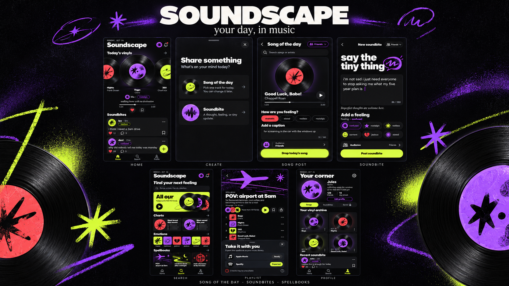
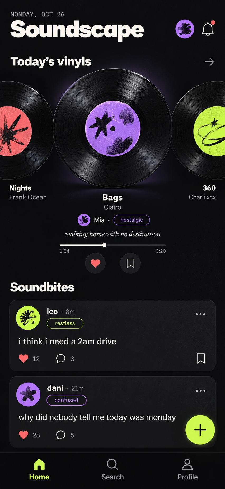
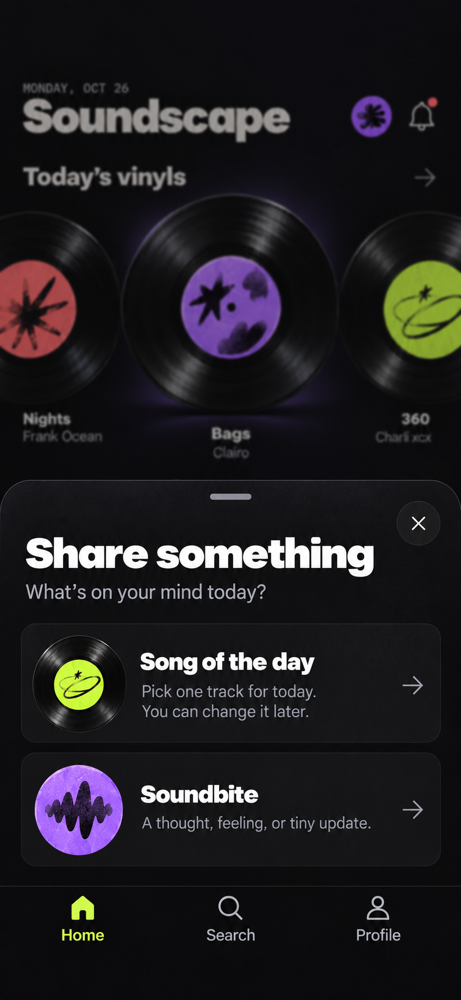
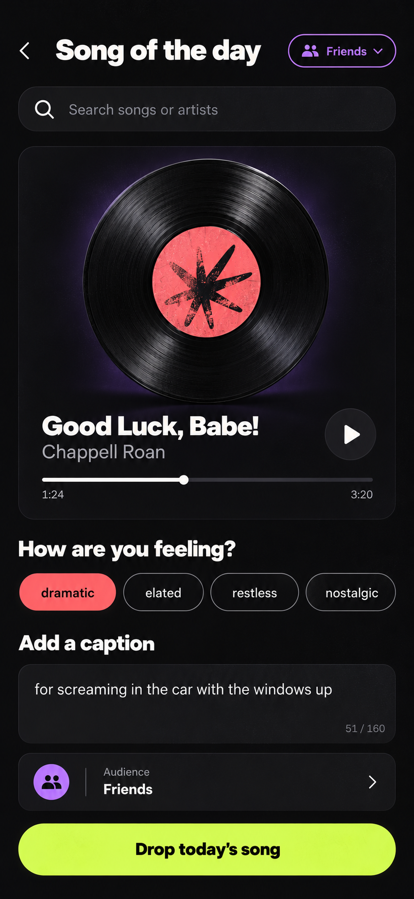
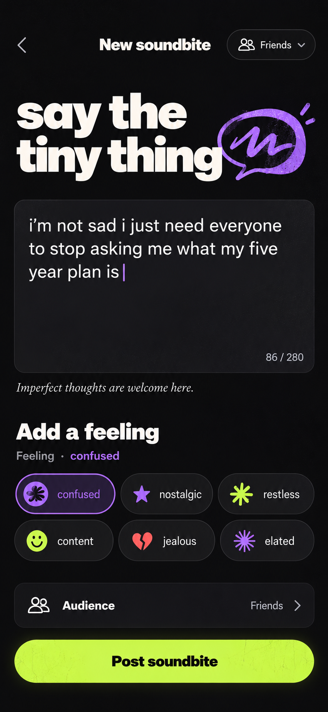
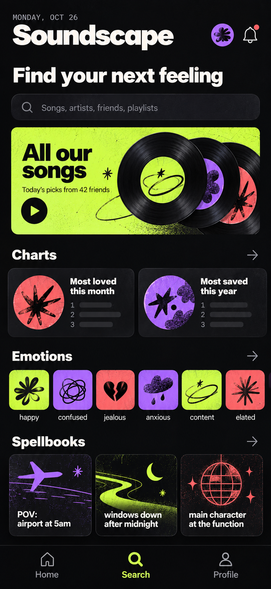
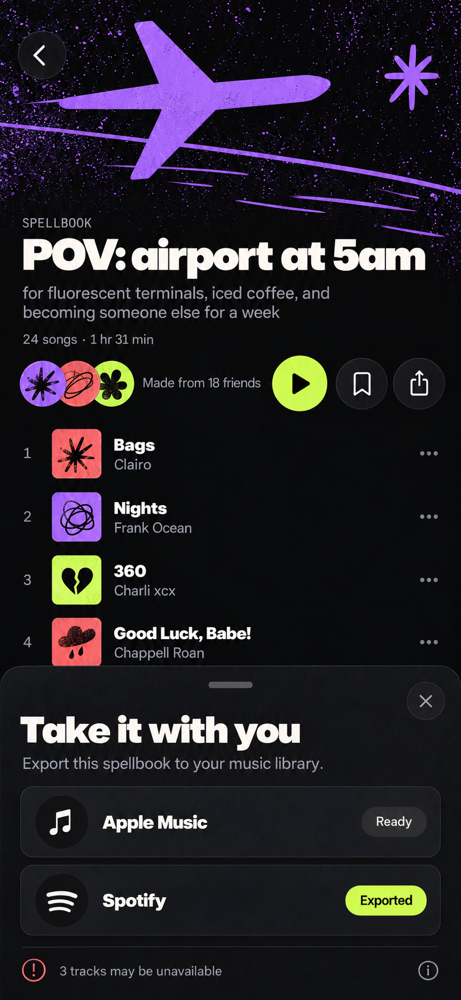
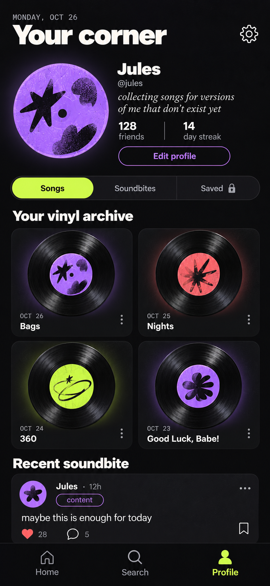

# Soundscape

**A song for today. A place to keep it.**

Soundscape is a friends-first social music concept built around one daily song and casual text “soundbites.” It is designed to feel more like a shared archive than a public performance.

## What it explores

- A daily vinyl carousel for friends’ song picks
- Lightweight reactions and a private saved-song library
- Low-pressure soundbites with optional feelings
- Emotion playlists, community charts, and “spellbook” POV mixes
- Simulated Apple Music and Spotify export flows
- A personal archive of songs and thoughts

## Native prototypes

The working prototype has been designed for both platforms:

- **iOS:** SwiftUI, SwiftData, and native iOS navigation
- **Android:** Jetpack Compose, Room, and native Android navigation

The application source is maintained in a separate private repository. This public showcase contains only synthetic product copy and design mockups—no credentials, private source code, or user data.

## Product gallery

| Home | Create | Song post |
| --- | --- | --- |
|  |  |  |

| Soundbite | Discover | Playlist export | Profile |
| --- | --- | --- | --- |
|  |  |  |  |

All names, profiles, posts, and activity shown here are fictional demo content.

